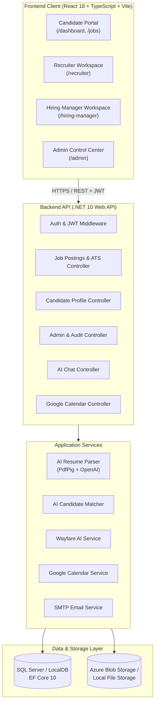

# Wayfare Global — AI-Powered Recruitment & Talent Management System

[](https://dotnet.microsoft.com/)
[](https://react.dev/)
[](https://www.typescriptlang.org/)
[](https://vitejs.dev/)
[](https://tailwindcss.com/)
[](https://openai.com/)
[](https://www.microsoft.com/sql-server)
[](LICENSE)

An enterprise-grade, end-to-end recruitment and talent orchestration platform powered by Artificial Intelligence. **Wayfare Global** automates and elevates every stage of the talent acquisition lifecycle—from intelligent resume parsing and multi-criteria candidate matching to collaborative interview scheduling, structured candidate scorecards, and system-wide audit governance.

---

## 📑 Table of Contents

- [Key Features](#-key-features)
- [System Architecture](#-system-architecture)
- [Role-Based Access Control (RBAC)](#-role-based-access-control-rbac)
- [Technology Stack](#-technology-stack)
- [Prerequisites](#-prerequisites)
- [Getting Started & Local Setup](#-getting-started--local-setup)
  - [1. Backend Setup (.NET 10 Web API)](#1-backend-setup-net-10-web-api)
  - [2. Frontend Setup (React + Vite)](#2-frontend-setup-react--vite)
- [Configuration & Environment Variables](#-configuration--environment-variables)
- [Default Seeded Credentials](#-default-seeded-credentials)
- [Interactive API Documentation](#-interactive-api-documentation)
- [End-to-End User Workflows](#-end-to-end-user-workflows)
- [Project Directory Structure](#-project-directory-structure)
- [Contributing & License](#-contributing--license)

---

## 🚀 Key Features

### 🧠 1. Artificial Intelligence & Automation
* **Automated AI Resume Parser**: Uses `PdfPig` text extraction combined with OpenAI (`gpt-4o-mini`) to parse uploaded PDF/Word resumes into structured candidate profiles (skills, work history, education, career headline, and biography).
* **AI Candidate-to-Job Matching**: Computes weighted suitability and compatibility scores between candidate profiles and job requirements.
* **Wayfare AI Assistant**: Real-time context-aware conversational AI assistant that helps candidates with preparation and queries, and assists recruiters with job drafting and evaluation.

### 👥 2. Collaborative Hiring & ATS Pipeline
* **Applicant Tracking System (ATS)**: Multi-stage pipeline (`Applied` ➔ `Shortlisted` ➔ `Interview` ➔ `UnderFinalReview` ➔ `Offer` ➔ `Hired` / `Rejected`).
* **Conflict-Free Interview Scheduling**: Supports `Video`, `Phone`, and `Onsite` interview formats with real-time interviewer conflict prevention.
* **Google Calendar Synchronization**: Synchronizes scheduled candidate interviews directly to Google Calendar.
* **Structured Evaluation Scorecards**: Standardized scorecards for Hiring Managers featuring technical assessment ratings, culture fit reviews, recommendations (`Strong Yes`, `Yes`, `Maybe`, `No`, `Strong No`), and comments.
* **Reschedule Requests**: Hiring Managers can request interview reschedules with audit-tracked reasons sent directly to the recruiting team.

### 🛡️ 3. Security, Governance & Administration
* **JWT-Based Authentication**: Secure stateless token authentication with BCrypt password hashing.
* **Audit Trail & Activity Logging**: Logs all security-relevant platform actions (user creation, logins, job postings, status changes, feedback submissions) with IP addresses and timestamps.
* **Department & Organization Management**: Multi-department hierarchy support for enterprise organizations.

---

## 🏛 System Architecture



---

## 🔑 Role-Based Access Control (RBAC)

| Role | Access URL | Capabilities |
| :--- | :--- | :--- |
| **System Administrator** | `/admin` | System health overview, user management (create Recruiter & Hiring Manager accounts), role permissions, audit logs, department management, global settings. |
| **Recruiter** | `/recruiter` | Create and publish job vacancies, review applicant pipeline, trigger AI match rankings, schedule interviews with conflict detection, manage candidate progression. |
| **Hiring Manager** | `/hiring-manager` | Review assigned department applicants, conduct interviews, submit structured scorecards & technical ratings, request interview reschedules, extend job offers. |
| **Candidate** | `/dashboard`, `/jobs` | Self-register profile, upload resume for automated AI extraction, browse open jobs, check match scores, track application statuses in real-time. |

---

## 🛠 Technology Stack

### Frontend
* **Core Framework**: React 18 (TypeScript)
* **Build Tool**: Vite 5.2
* **Styling**: Tailwind CSS 3.4, PostCSS, Autoprefixer
* **Motion & Animation**: Framer Motion 11
* **Icons**: Lucide React
* **Routing**: React Router DOM v6
* **Utilities**: Date-fns, Tailwind-Merge

### Backend
* **Runtime & Framework**: C# / .NET 10.0 Web API
* **ORM & Database**: Entity Framework Core 10, Microsoft SQL Server / LocalDB
* **Security & Auth**: JWT Bearer Tokens, BCrypt.Net-Next
* **Document Parsing**: UglyToad.PdfPig 1.7
* **Cloud Storage**: Azure Storage Blobs SDK
* **AI Integration**: OpenAI REST API (`gpt-4o-mini`)
* **API Documentation**: Microsoft.AspNetCore.OpenApi, Swashbuckle (Swagger UI), Scalar.AspNetCore
* **Mailing**: SMTP MailKit / System.Net.Mail

---

## 📦 Prerequisites

Ensure you have the following installed on your development machine:

1. **[.NET 10 SDK](https://dotnet.microsoft.com/download)** (or latest .NET SDK supporting net10.0)
2. **[Node.js](https://nodejs.org/)** (v18.0 or higher) & **npm** (or **bun** / **pnpm**)
3. **[SQL Server LocalDB](https://learn.microsoft.com/en-us/sql/database-engine/configure-windows/sql-server-express-localdb)** (comes pre-installed with Visual Studio) or **Microsoft SQL Server**

---

## 🏁 Getting Started & Local Setup

### 1. Clone the Repository
```bash
git clone https://github.com/Maduranga14/AI-powered-Recruitment-and-talent-management-system.git
cd AI-powered-Recruitment-and-talent-management-system
```

---

### 1. Backend Setup (.NET 10 Web API)

1. Navigate to the backend directory:
   ```bash
   cd backend
   ```

2. Restore NuGet dependencies:
   ```bash
   dotnet restore
   ```

3. Configure your connection string and API keys in `appsettings.json` (see [Configuration](#-configuration--environment-variables)).

4. Run the backend server:
   ```bash
   dotnet run
   ```
   > **Note**: On startup, Entity Framework Core will automatically execute database migrations and seed default administrative accounts and departments!

* **Backend Base URL**: `http://localhost:5073`
* **Swagger UI**: `http://localhost:5073/swagger`
* **Scalar API Docs**: `http://localhost:5073/scalar/v1`

---

### 2. Frontend Setup (React + Vite)

1. Open a new terminal and navigate to the frontend directory:
   ```bash
   cd frontend
   ```

2. Install dependencies:
   ```bash
   npm install
   # or
   bun install
   ```

3. Start the Vite development server:
   ```bash
   npm run dev
   # or
   bun run dev
   ```

* **Frontend Web Application**: `http://localhost:5173`

---

## ⚙️ Configuration & Environment Variables

Backend settings are managed inside `backend/appsettings.json`:

```json
{
  "ConnectionStrings": {
    "DefaultConnection": "Server=(localdb)\\mssqllocaldb;Database=WayfareGlobalDb;Trusted_Connection=True;MultipleActiveResultSets=true;TrustServerCertificate=True;"
  },
  "JwtSettings": {
    "Secret": "YourSuperSecretJWTKeyHereWithAtLeast32Chars!",
    "Issuer": "WayfareAPI",
    "Audience": "WayfareClient",
    "ExpiryInHours": 8
  },
  "FrontendBaseUrl": "http://localhost:5173",
  "OpenAI": {
    "ApiKey": "your-openai-api-key",
    "Model": "gpt-4o-mini",
    "BaseUrl": "https://api.openai.com/v1"
  },
  "SmtpSettings": {
    "Server": "smtp.gmail.com",
    "Port": 587,
    "SenderName": "Wayfare Global",
    "SenderEmail": "notifications@wayfareglobal.com",
    "Username": "your-email@gmail.com",
    "Password": "your-email-app-password",
    "EnableSsl": true
  },
  "GoogleCalendar": {
    "ClientId": "your-google-client-id",
    "ClientSecret": "your-google-client-secret",
    "RedirectUri": "http://localhost:5173/hiring-manager?tab=calendar"
  }
}
```

---

## 🔑 Default Seeded Credentials

When starting the application with a clean database, the system automatically provisions the default administrator:

| Field | Default Value |
| :--- | :--- |
| **Role** | System Administrator |
| **Email** | `admin@wayfareglobal.com` |
| **Password** | `Admin@12345` |
| **Dashboard** | `http://localhost:5173/login` ➔ Redirects to `/admin` |

> **Pro Tip**: Use this Admin account to provision your **Recruiters** and **Hiring Managers** via `/admin` ➔ **People & Roles** ➔ **Add Person**.

---

## 📖 Interactive API Documentation

Wayfare Global provides two fully documented, interactive API interfaces:

1. **Classic Swagger UI**:
   - URL: **`http://localhost:5073/swagger`**
   - Click **Authorize 🔓** at the top right and enter your Bearer token: `Bearer <your_token>`.
2. **Modern Scalar Interface**:
   - URL: **`http://localhost:5073/scalar/v1`**
   - Dark-themed, modern interactive API explorer.

---

## 🔄 End-to-End User Workflows

```
1. Admin Setup
   └─ Admin logs in ──► Creates Recruiter & Hiring Manager accounts in "People & Roles"

2. Candidate Registration & Profile
   └─ Candidate registers at /register ──► Uploads Resume ──► AI auto-populates skills & experience

3. Job Posting & Application
   └─ Recruiter publishes job opening ──► Candidate views job with AI match score & applies

4. Screening & Interview
   └─ Recruiter runs AI Candidate Match ──► Moves candidate to "Interview" stage
   └─ Recruiter schedules interview with conflict detection & assigns Hiring Manager

5. Evaluation & Offer
   └─ Hiring Manager reviews candidate ──► Submits scorecard & feedback ──► Extends offer / Hires
```

---

## 📁 Project Directory Structure

```text
AI-powered-Recruitment-and-talent-management-system/
├── backend/
│   ├── Controllers/            # API Controllers (Auth, Jobs, Candidates, Admin, AI, etc.)
│   ├── Data/                   # AppDbContext and automatic database seeder (DbSeeder.cs)
│   ├── DTOs/                   # Data Transfer Objects for requests and responses
│   ├── Migrations/             # EF Core database migrations
│   ├── Models/                 # Database entity models (User, JobPosting, Interview, etc.)
│   ├── Services/               # Business logic, AI parsers, Calendar, and Auth services
│   ├── appsettings.json        # Application configuration
│   ├── Program.cs              # Application entry point and DI configuration
│   └── backend.csproj          # Project dependencies (.NET 10)
│
├── frontend/
│   ├── public/                 # Static assets
│   ├── src/
│   │   ├── components/         # Reusable UI components (Admin, Recruiter, Dashboard, Modals)
│   │   ├── context/            # React context providers (AuthContext, etc.)
│   │   ├── pages/              # Main view pages (Admin, Recruiter, HiringManager, Dashboard)
│   │   ├── services/           # Axios/Fetch API client layer (api.ts)
│   │   ├── App.tsx             # Root routing and layout component
│   │   └── main.tsx            # Application entry point
│   ├── package.json            # Frontend dependencies and scripts
│   ├── tailwind.config.js      # Tailwind CSS design system configuration
│   └── vite.config.ts          # Vite bundler configuration
│
└── README.md                   # Project documentation
```

---

## 📄 License

This project is licensed under the **MIT License**. See the [LICENSE](LICENSE) file for more details.

---

<p align="center">
  <b>Wayfare Global</b> — Empowering modern talent acquisition with intelligent automation.
</p>
